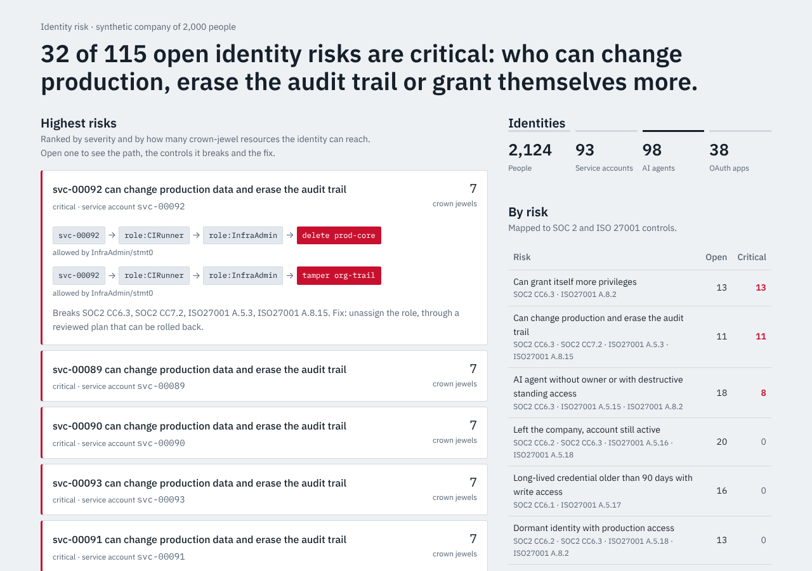

# identity-risk-graph

**Identity risk management and enforcement for SaaS, cloud and AI agents, in Go.**

It reads a company's identity estate:
- people and groups in the IdP;
- HR status;
- AWS IAM roles, policies, trust chains and keys;
- third-party OAuth apps;
- AI agents.

From that it builds an identity graph and **evaluates what every identity can actually do**,
including IAM conditions, Deny statements and assume-role chains. It turns the risky paths into
findings mapped to SOC 2 and ISO 27001 controls, and fixes them through reviewed, reversible
plans. AI agents ask it before they act, and get an answer in microseconds.

```
estate APIs ──► connector ──► snapshot ──► graph + IAM evaluation ──► findings (9 rules, evidence path,
 (IdP, HR, AWS,   (paged,                     per auth context:          blast radius, controls)
  Workspace,       idempotent                 MFA / no MFA / key)               │
  agents)          writes) ◄── apply/rollback ◄── four-eyes plan ◄── dry run ◄──┘
                                                                         AI agent ──► /v1/agents/decide
 audit log + agent decisions ──► SIEM export (Splunk HEC, Microsoft Sentinel; ECS events, cursor per sink)
 every request, job and estate call ──► OpenTelemetry traces (OTLP/HTTP) ──► Collector ──► Tempo / Grafana
```



`web/` is the dashboard above (React, TanStack Query, Framer Motion). `irg dashboard` writes its data
from the engine and the committed reports; nothing in it is typed by hand.

## What was measured

All figures come from [`reports/`](reports) and are produced by `irg bench` and `scripts/demo.sh`.
Hardware: one 2-vCPU machine.

| | Result |
|---|---|
| **Detection vs ground truth** (5 synthetic companies, 2,000 people each, 575 planted risks plus deliberate near-misses) | **precision 1.00, recall 1.00**, 0 false positives |
| Same companies, **naive configuration scanner** (matches group names and policy strings) | precision **0.24**, recall 0.91, **1,645 false positives** |
| Whole-organisation analysis, 50,000 people (58,889 identities, 538k edges) | **0.96 s**, 244 MB peak heap |
| AI-agent decision, in process | p50 **2.7 µs**, p99 **19 µs**, 580k decisions/s |
| AI-agent decision over HTTP (auth, rate limit, decision, async logging to PostgreSQL) | **14,658 req/s**, p99 **9.6 ms**, 0 errors, 293,494 of 293,494 decisions persisted |

The naive scanner is wrong in the ways real tools are wrong. It flags:
- admins without MFA whose admin policy *requires* MFA, so they hold no admin access at all;
- SREs whose `NotAction: iam:*` it reads as IAM access;
- deploy roles with `iam:PassRole` scoped to application roles only;
- read-only keys that are merely old;
- verified vendors with broad scopes;
- people who left the company and were properly deprovisioned.

**Limits, stated plainly.**
- The ground truth is planted by a generator (`internal/synth`). It shows the logic is right on
  known cases, including the hard near-misses. It does not measure recall on a real estate.
- The connectors talk to a stand-in estate with the same API shapes (`internal/estate`), not to
  live Okta, AWS or Google tenants.
- IAM evaluation covers identity policies with Allow and Deny, wildcards, `NotAction` and
  `NotResource`, and 18 condition operators. Resource-based policies, SCPs and permission
  boundaries as separate layers are on the roadmap ([SECURITY.md](docs/SECURITY.md)).

## What it finds

| Rule | Meaning | Controls |
|---|---|---|
| `offboarding_gap` | left the company (HR), IdP account still active | SOC 2 CC6.2/6.3 · ISO 5.16, 5.18 |
| `dormant_privileged` | no sign-in for 90+ days, can still change crown jewels | CC6.2/6.3 · 5.18, 8.2 |
| `privileged_without_mfa` | production access *in a no-MFA context* | CC6.1 · 8.5 |
| `privilege_escalation` | can call `iam:Attach*`, `iam:PassRole` on `*`… via any path, including assume chains | CC6.3 · 8.2 |
| `toxic_combination` | can change production data **and** stop the audit trail | CC6.3, CC7.2 · 5.3, 8.15 |
| `stale_credential` | key older than 90 days with write access | CC6.1 · 5.17 |
| `ai_agent_risk` | AI agent without an owner, or with destructive standing access to crown jewels | CC6.3 · 5.15, 8.2 |
| `risky_oauth_app` | unverified third-party app holding mail, drive or directory scopes | CC6.6, CC9.2 · 5.19, 5.23 |
| `external_privileged` | external identity that can reach crown jewels | CC6.6 · 5.19, 8.2 |

Each finding carries:
- the evidence path, for example `svc-00067 → role:CIRunner → role:InfraAdmin → tamper org-trail (allowed by InfraAdmin/stmt0)`;
- the blast radius;
- a score;
- a reversible remediation.

## Fixing safely

1. **Plan.** An analyst selects findings. The plan is guardrailed: break-glass and protected
   identities are never touched, and the number of actions is capped.
2. **Dry run.** It shows the findings resolved, other findings fixed as a side effect, the
   crown-jewel access each identity loses, and **proof of no new findings**.
3. **Approve.** A *different* admin approves. The author cannot.
4. **Execute.** Steps run one at a time, each with an idempotency key and its undo persisted. A
   crash resumes without repeating a step.
5. **Verify.** A re-sync confirms the estate actually changed.
6. **Rollback.** Replays the undos in reverse.

## AI agents

`POST /v1/agents/decide {agent_id, action, resource}` returns `allow`, `deny` or
`require_approval`, with the reason and the access path. The checks, in order:
- the agent is known, active and not quarantined;
- it has a human owner;
- it is within its rate limit;
- an approved, time-boxed **just-in-time grant** matches;
- it has standing access in the graph;
- destructive actions on crown jewels need a human, even when the agent has access.

## Built to be operated

- **Multi-tenant by PostgreSQL row-level security.** The app runs as a non-owner role. A query
  missing a tenant filter still sees one tenant, and a missing tenant sees nothing. Proven by
  tests.
- **Authentication.**
  - OIDC JWT verification (RS256/ES256, JWKS rotation) written with the standard library. Tests
  show it rejects `alg: none`, forged payloads and key/algorithm confusion.
  - Hashed API keys, scoped to the roles viewer, analyst, admin and agent.
- **Tamper-evident audit log.** Each row's hash covers the previous one, and
  `GET /v1/audit/verify` names the first altered row.
- **LLM explanations on AWS Bedrock.** Converse API, with SigV4 written from scratch and verified
  against AWS's published example. The LLM **explains and never acts** (ADR-0006).
- **Deployment.**
  - A distroless non-root image.
  - Kubernetes manifests with the restricted Pod Security Standard, read-only root filesystems,
    default-deny network policies, an HPA and PDBs, and secrets mounted as files.
  - **Terraform for AWS**: VPC across 3 AZs, EKS with KMS secret encryption and audit logs,
    Multi-AZ RDS PostgreSQL (TLS only, IAM authentication, enhanced monitoring), IMDSv2 nodes,
    and a least-privilege IRSA role.

## Security operations: SIEM export and tracing

**SIEM export.** Every audit-log entry (plans applied and rolled back, risks accepted, grants
approved, keys created) and every AI-agent decision that was not a plain allow goes to the customer's
SIEM as an [Elastic Common Schema](https://www.elastic.co/guide/en/ecs/current/index.html) event:

- **Splunk** through the HTTP Event Collector, **Microsoft Sentinel** through the Azure Monitor Logs
  Ingestion API (Entra ID client-credentials token, requests split under 1 MB).
- One cursor per tenant, sink and stream in PostgreSQL (row-level security like everything else),
  moved only after the sink acknowledged the batch: **at-least-once**, with a stable event id so the
  SIEM can drop the rare duplicate.
- Busy replies and timeouts are retried with backoff (and `Retry-After`); a sink that rejects us
  (bad token, bad schema) is alerted on and **skips nothing**, while the other sinks carry on.
- Agent decisions are read after a 10-second settling window, because concurrent API replicas can
  commit a lower id after a higher one; the audit log needs none (appends are serialised per tenant).

`irg siem-drill` measures it against a SIEM that answers 20% of requests "busy" and loses 3% of its
acknowledgements after storing the events ([reports/siem.json](reports/siem.json)):

| | |
|---|---|
| Security events to deliver (2,000 audit entries, 19,909 of 50,000 decisions that were not plain allows) | 21,909 |
| **Missing at the SIEM** | **0** |
| Busy replies, lost acknowledgements | 29, 2 |
| Duplicate deliveries (only from the lost acknowledgements, each with the same event id) | 400 |
| Events from another tenant, plain allows exported | 0, 0 |

**OpenTelemetry tracing.** The API, the worker and the connector record spans and send them over
OTLP/HTTP to any OpenTelemetry Collector (`OTEL_EXPORTER_OTLP_ENDPOINT`). The W3C `traceparent` header
is continued from the caller and **carried through the job queue**, so one trace runs from
`POST /v1/sync` through the sync job, every estate API call and the analysis job it schedules. An
agent's decision is a span with its agent, action, resource, decision and reason. The tracer is the
standard library only, like the metrics; a full queue drops spans instead of blocking a request,
and two spans cost about 1.7 µs. CI sends spans to a real OpenTelemetry Collector and requires it to
write out every one. [deploy/observability/otel-collector.yaml](deploy/observability/otel-collector.yaml)
keeps every failed trace and every denied agent action, 10% of the rest, and forwards to Tempo.

**Dashboards and alerts.** A Grafana board
([grafana-dashboard.json](deploy/observability/grafana-dashboard.json)) for identity risk, agent
decisions, the API, jobs, SIEM delivery and tracing, and Prometheus alerts
([prometheus-rules.yml](deploy/observability/prometheus-rules.yml)): a multi-window burn rate on the
99.9% API budget, slow agent decisions, a SIEM rejecting events or falling behind, dropped spans, a
critical identity risk open for an hour. The alerts are unit-tested with `promtool`, and a Go test
checks that every metric the board and the alerts query is one the code registers.

## Run it

```bash
DATABASE_URL=postgres://… scripts/demo.sh    # estate + API + worker, sync, posture, HTTP load test
```

Or by hand:

```bash
go build -o bin/irg ./cmd/irg
bin/irg estate -humans 2000 &                                    # synthetic company on :9090
bin/irg migrate && bin/irg tenant create acme Acme acme.example   # prints the admin key
bin/irg tenant set <tenant-id> estate_url http://localhost:9090
IRG_ESTATE_TOKEN= bin/irg all                                     # API on :8080 + worker
curl -H "Authorization: Bearer $KEY" -X POST localhost:8080/v1/sync
curl -H "Authorization: Bearer $KEY" localhost:8080/v1/posture
bin/irg bench -out reports                                        # regenerate the reports
bin/irg siem-drill -out reports/siem.json                         # SIEM delivery under failure
bin/irg dashboard && (cd web && npm install && npm run dev)       # the CISO dashboard
OTEL_EXPORTER_OTLP_ENDPOINT=http://localhost:4318 bin/irg all     # with traces to a collector
```

## CI

Every push runs these jobs:

- **go:** gofmt, vet, golangci-lint with gosec, race tests against PostgreSQL, 30 s of fuzzing,
  govulncheck, and the benchmarks.
- **iac:** terraform fmt and validate; kubeconform; Checkov on Terraform, the rendered production
  manifests and the Dockerfile, with zero unsuppressed findings. Each suppression states its
  reason in the file.
- **kind:** builds the image and deploys Postgres, the estate, two API pods and two workers. It
  then runs the whole flow (tenant, sync, analysis, four-eyes plan, apply, verified resolved,
  audit chain intact, agent decisions), and a **rolling restart under load that must drop zero
  requests**.
- **otel:** starts an OpenTelemetry Collector, exports spans to it, and requires all of them in its
  output; validates the production collector config.
- **observability:** `promtool` checks and unit-tests the alert rules.
- **dashboard:** the CISO dashboard's tests and build.

## Leadership documents

| Document | What it covers |
|---|---|
| [ARCHITECTURE.md](docs/ARCHITECTURE.md) | design, build vs buy, scaling notes |
| [SECURITY.md](docs/SECURITY.md) | STRIDE threat model with the control and test for each threat; known gaps in priority order |
| [ADRs](docs/adr) | six decisions with context and consequences |
| [Engineering handbook](docs/engineering/HANDBOOK.md) | planning, code review, definition of done, releases, on-call, incident response with severities and the GDPR timeline |
| [Hiring plan](docs/engineering/HIRING.md) | team shape from 5 to 20, hiring order, interview loop, onboarding |
| [SOC 2 and ISO 27001 controls](docs/compliance/CONTROLS.md) | product findings mapped to controls; our own controls with evidence pointers; audit gaps |
| [Runbook](docs/RUNBOOK.md) | service levels, alerts, revocation, deploy and rollback |

MIT licence.
